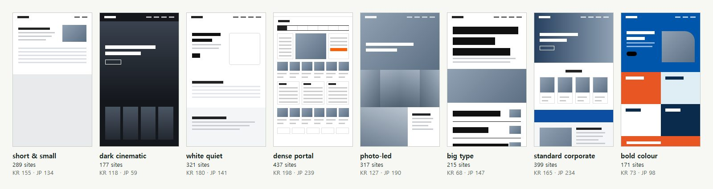
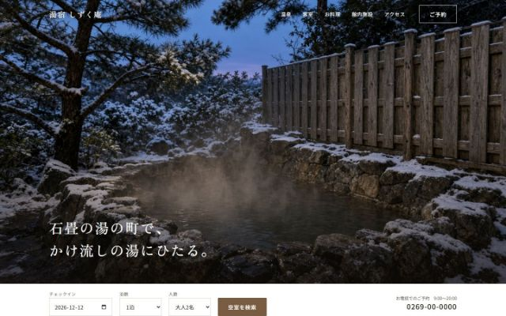
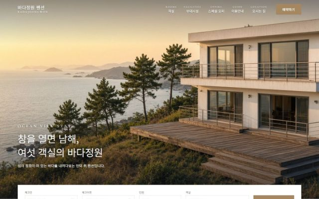
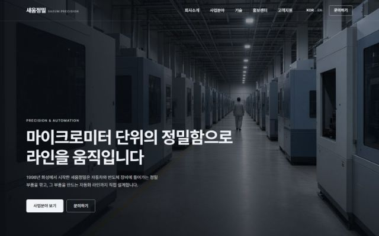
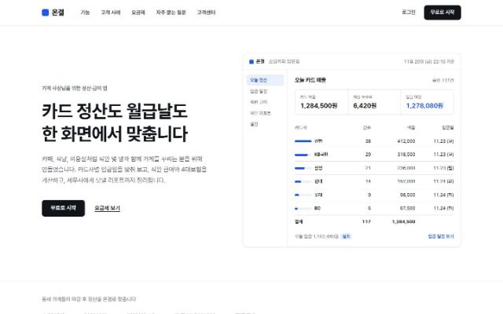
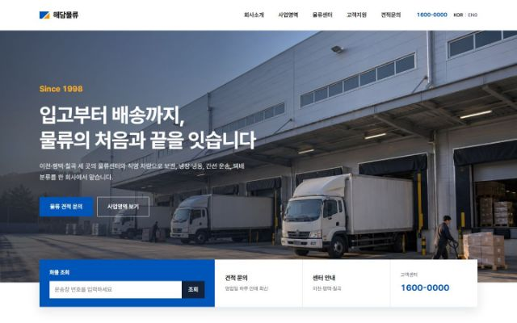
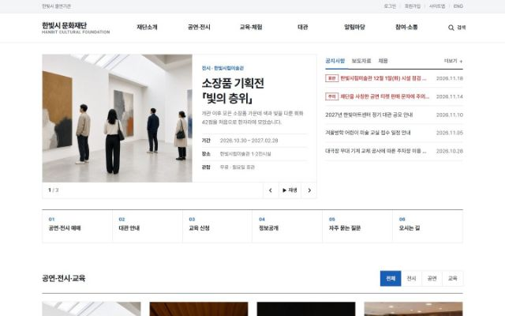
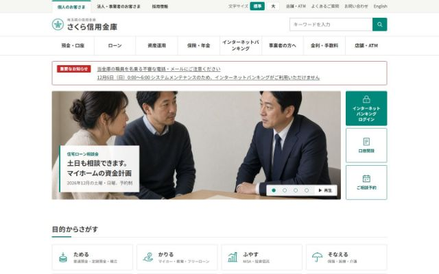
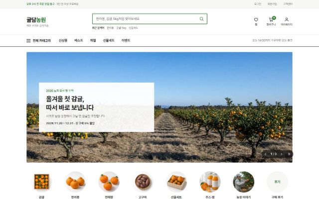
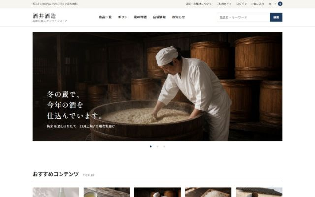

# UI Refiner

English | [한국어](README_KO.md) | [日本語](README_JA.md)

UI Refiner includes 14 web design themes built from measurements of 2,326 Korean and Japanese sites. Use them to build pages with Codex or Claude Code, or review an existing page from the CLI.

## How the themes are built

**1. Eight page types.** The 2,326 sites fall into eight types by overall impression. Each diagram shows a type's measured average: ground, photographs, type size, and density.



**2. Six trade families.** Trades are grouped by what a visitor comes to do.

| Family | Trades | Korea | Japan |
|---|---|---|---|
| place | inns, tourism, restaurants, weddings | 143 | 156 |
| care | clinics, hospitals, care, salons, fitness | 175 | 259 |
| public | government, associations, universities, media, finance | 202 | 179 |
| shop | e-commerce, fashion, cosmetics, food | 199 | 165 |
| business | makers, logistics, software, builders, tax, hiring | 235 | 249 |
| creative | design, games, architecture, photo, illustration | 130 | 234 |

**3. Fourteen themes.** Each theme is a finished design for a page type common to one family in one country, with sizes, colors, and layouts taken from those sites. The count next to a theme is how many sites of that type appear in that family and country: for example, `business-white` rests on 50 of the 235 Korean business sites. The country label shows only where the theme was measured, not where you can use it: a Korean clinic can use a theme measured in Japan, and `theme starter --lang` adapts the typography to the page's language.

<!-- theme-grid:start (node scripts/build-theme-grid.mjs) -->
<table>
<tr>
<td align="center" valign="top" width="33%">
<a href="skills/ui-refiner-agent/reference/themes/place-photo-quiet/theme.md"></a><br>
<b><a href="skills/ui-refiner-agent/reference/themes/place-photo-quiet/theme.md">place-photo-quiet</a></b><br>
<sub>photo-led · 65 Japanese sites</sub>
</td>
<td align="center" valign="top" width="33%">
<a href="skills/ui-refiner-agent/reference/themes/place-photo-view/theme.md"></a><br>
<b><a href="skills/ui-refiner-agent/reference/themes/place-photo-view/theme.md">place-photo-view</a></b><br>
<sub>photo-led · 43 Korean sites</sub>
</td>
<td align="center" valign="top" width="33%">
<a href="skills/ui-refiner-agent/reference/themes/care-white/theme.md"></a><br>
<b><a href="skills/ui-refiner-agent/reference/themes/care-white/theme.md">care-white</a></b><br>
<sub>white quiet · 38 Korean sites</sub>
</td>
</tr>
<tr>
<td align="center" valign="top" width="33%">
<a href="skills/ui-refiner-agent/reference/themes/care-corporate/theme.md"></a><br>
<b><a href="skills/ui-refiner-agent/reference/themes/care-corporate/theme.md">care-corporate</a></b><br>
<sub>standard corporate · 68 Japanese sites</sub>
</td>
<td align="center" valign="top" width="33%">
<a href="skills/ui-refiner-agent/reference/themes/business-dark/theme.md"></a><br>
<b><a href="skills/ui-refiner-agent/reference/themes/business-dark/theme.md">business-dark</a></b><br>
<sub>dark cinematic · 35 Korean sites</sub>
</td>
<td align="center" valign="top" width="33%">
<a href="skills/ui-refiner-agent/reference/themes/business-white/theme.md"></a><br>
<b><a href="skills/ui-refiner-agent/reference/themes/business-white/theme.md">business-white</a></b><br>
<sub>white quiet · 50 Korean sites</sub>
</td>
</tr>
<tr>
<td align="center" valign="top" width="33%">
<a href="skills/ui-refiner-agent/reference/themes/business-corporate-quickbar/theme.md"></a><br>
<b><a href="skills/ui-refiner-agent/reference/themes/business-corporate-quickbar/theme.md">business-corporate-quickbar</a></b><br>
<sub>standard corporate · 41 Korean sites</sub>
</td>
<td align="center" valign="top" width="33%">
<a href="skills/ui-refiner-agent/reference/themes/business-corporate-message/theme.md"></a><br>
<b><a href="skills/ui-refiner-agent/reference/themes/business-corporate-message/theme.md">business-corporate-message</a></b><br>
<sub>standard corporate · 52 Japanese sites</sub>
</td>
<td align="center" valign="top" width="33%">
<a href="skills/ui-refiner-agent/reference/themes/public-portal-search/theme.md"></a><br>
<b><a href="skills/ui-refiner-agent/reference/themes/public-portal-search/theme.md">public-portal-search</a></b><br>
<sub>dense portal · 61 Korean sites</sub>
</td>
</tr>
<tr>
<td align="center" valign="top" width="33%">
<a href="skills/ui-refiner-agent/reference/themes/public-portal-purpose/theme.md"></a><br>
<b><a href="skills/ui-refiner-agent/reference/themes/public-portal-purpose/theme.md">public-portal-purpose</a></b><br>
<sub>dense portal · 64 Japanese sites</sub>
</td>
<td align="center" valign="top" width="33%">
<a href="skills/ui-refiner-agent/reference/themes/shop-portal-grid/theme.md"></a><br>
<b><a href="skills/ui-refiner-agent/reference/themes/shop-portal-grid/theme.md">shop-portal-grid</a></b><br>
<sub>dense portal · 60 Korean sites</sub>
</td>
<td align="center" valign="top" width="33%">
<a href="skills/ui-refiner-agent/reference/themes/shop-portal-story/theme.md"></a><br>
<b><a href="skills/ui-refiner-agent/reference/themes/shop-portal-story/theme.md">shop-portal-story</a></b><br>
<sub>dense portal · 57 Japanese sites</sub>
</td>
</tr>
<tr>
<td align="center" valign="top" width="33%">
<a href="skills/ui-refiner-agent/reference/themes/creative-dark/theme.md"></a><br>
<b><a href="skills/ui-refiner-agent/reference/themes/creative-dark/theme.md">creative-dark</a></b><br>
<sub>dark cinematic · 34 Korean sites</sub>
</td>
<td align="center" valign="top" width="33%">
<a href="skills/ui-refiner-agent/reference/themes/creative-bigtype/theme.md"></a><br>
<b><a href="skills/ui-refiner-agent/reference/themes/creative-bigtype/theme.md">creative-bigtype</a></b><br>
<sub>big type · 36 Japanese sites</sub>
</td>
<td width="33%"></td>
</tr>
</table>
<!-- theme-grid:end -->

[Theme gallery](skills/ui-refiner-agent/reference/themes/GALLERY.md) · [Measurement method and catalog](skills/ui-refiner-agent/reference/themes/README.md)

**4. One family in all eight types.** Any family can be drawn in any type. Here, the Korean business family is drawn eight ways for one fictional manufacturer. Three of the eight types have a theme: dark cinematic, white quiet, and standard corporate. The other five exist only as demonstration samples built from the measured values of their type and are not offered as themes. The counts show how common each combination is: among Korean business sites, 50 are white quiet and 15 are bold colour.


[Demonstration pages and counts](docs/archetype-demo/README.md)

## Quick start

Requires Node.js 22.18 or later, npm, and Git. To use UI Refiner with an existing app, run these commands from the app root.

```sh
git clone https://github.com/prentice7725/ui-refiner tools/ui-refiner
cd tools/ui-refiner
npm ci
npx playwright install chromium
node bin/ui-refiner.mjs doctor
node bin/ui-refiner.mjs scan examples/ai-slop-landing.html --lang en
```

Open `ui-refiner-scan/DESIGN_REVIEW.md` after the sample scan; desktop and mobile screenshots are saved alongside it. Replace the example path with a URL or local HTML file to scan your own page. Rescanning the same page into the same output folder adds a before-and-after comparison.

## Connect an agent

From the `tools/ui-refiner` directory above, run the command for your host. CLI-only users can skip this step.

| Host | Install | Use in your app project |
|---|---|---|
| Codex | `node scripts/install-agent-skill.mjs ../.. --host codex` | Open a new chat and ask, “Review the design of landing.html” |
| Claude Code | `node scripts/install-agent-skill.mjs ../.. --host claude` | Review with `/ui-review landing.html` or refine with `/ui-refine landing.html` |

Run the installer again to check the installed version and file differences. Pass `--update` to apply available updates; locally modified files are flagged for review.

<details>
<summary>Install as a Claude Code plugin</summary>

Run these commands in Claude Code, then run `npm ci` and `npx playwright install chromium` in the plugin folder.

```text
/plugin marketplace add prentice7725/ui-refiner
/plugin install ui-refiner@ui-refiner
```

</details>

## What you can do

- **Review a page.** `scan` explains each detected design signal and suggests how to fix it. The 0–100 score measures the strength of detected patterns, while quality issues such as text contrast are reported separately. Reports support English, Korean, and Japanese via `--lang en`, `ko`, or `ja`.
- **Refine an existing design.** For smaller edits, the agent keeps the existing structure. For a full redesign, it starts a Korean or Japanese trade page from the matching theme; other pages—or anyone asking for options—get three directions to choose from. Use `keep check` to verify that links, forms, and figures survived the edits, and `stress` to test the layout against longer labels and larger numbers.
- **Build a new page.** The 14 themes draw on measurements from 2,326 Korean and Japanese sites. Open the gallery in a browser from your local checkout to filter samples by trade and photo availability. `ui-refiner theme starter <theme> --brand "#rrggbb"` copies a theme into your project with your brand color applied, lists the photographs it needs, and flags any contrast the color breaks. Passing `--lang` adapts the typography to Korean or Japanese, and three themes (`care-white`, `place-photo-quiet`, `business-white`) include an optional `--variant statement` for clients who want to stand out.

In a three-page pilot, the three-direction workflow achieved the best mean rank for individual pages, though the resulting pages were judged similar as a set. A single model judged the designs. [Pilot results](docs/refine-pilot-2026-11-15-local/results-five-arms.json)

[Full guide and project QA setup](docs/GUIDE.md) · [Changelog](CHANGELOG.md) · [MIT](LICENSE) · [Third-party notices](licenses/THIRD_PARTY.md)
