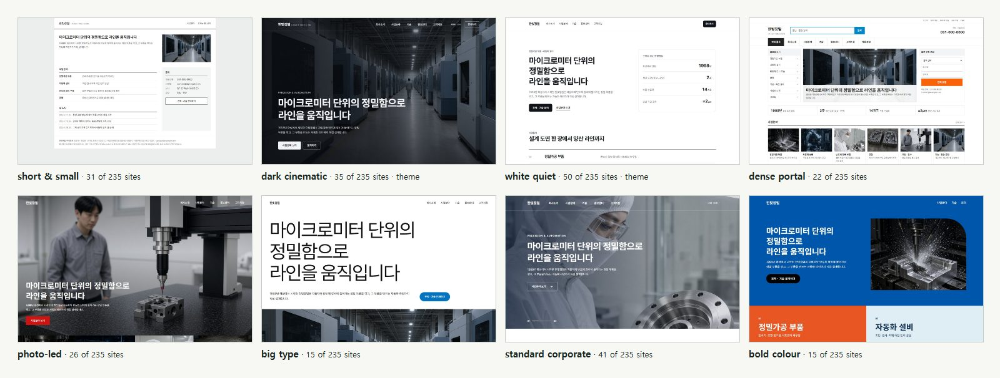

# UI Refiner

[English](README.md) · [한국어](README_KO.md) · [日本語](README_JA.md)

UI Refiner includes 13 web design themes based on measurements from 2,326 Korean and Japanese sites. Use them to build a page with Codex or Claude Code, or review an existing page with the CLI.

## How the themes are built

**1. Eight types of page.** The 2,326 sites fall into eight types by overall impression. Each drawing shows a type's measured average: ground, photographs, type size and density.


**2. Six families of trade.** Trades are grouped by what a visitor comes to do.

| Family | Trades | Korea | Japan |
|---|---|---|---|
| place | inns, tourism, restaurants, weddings | 143 | 156 |
| care | clinics, hospitals, care, salons, fitness | 175 | 259 |
| public | government, associations, universities, media, finance | 202 | 179 |
| shop | e-commerce, fashion, cosmetics, food | 199 | 165 |
| business | makers, logistics, software, builders, tax, hiring | 235 | 249 |
| creative | design, games, architecture, photo, illustration | 130 | 153 |

**3. Thirteen themes.** Each theme is a finished design for a type that is common in one family in one country, with its sizes, colours and layout taken from those sites. The count next to a theme is the number of sites of that type in that family and country: `kr-business-white` rests on 50 of the 235 Korean business sites.


[Theme gallery](skills/ui-refiner-agent/reference/themes/GALLERY.md) · [Measurement method and catalog](skills/ui-refiner-agent/reference/themes/README.md)

**4. One family in all eight types.** Any family can be drawn in any type. Here the Korean business family is drawn eight ways for one fictional maker. Two of the eight are themes. The other six are demonstration samples built from the measured values of their type, and are not offered as themes. The counts show how common each combination is: 50 Korean business sites are white quiet and 15 are bold colour.



[Demonstration pages and counts](docs/archetype-demo/README.md)

## Quick start

Requires Node.js 22.18 or later, npm and Git. To use UI Refiner with an existing app, run these commands from the app root.

```sh
git clone https://github.com/prentice7725/ui-refiner tools/ui-refiner
cd tools/ui-refiner
npm ci
npx playwright install chromium
node bin/ui-refiner.mjs doctor
node bin/ui-refiner.mjs scan examples/ai-slop-landing.html --lang en
```

Open `ui-refiner-scan/DESIGN_REVIEW.md` after the sample scan. Desktop and mobile screenshots are saved alongside it. Replace the example with a URL or local HTML path to scan your page. Rescan the same page into the same output folder for a before-and-after comparison.

## Connect an agent

From the `tools/ui-refiner` checkout above, run the command for your host. CLI users can skip this step.

| Host | Install | Use in your app project |
|---|---|---|
| Codex | `node scripts/install-agent-skill.mjs ../.. --host codex` | Open a new chat and ask “Review the design of landing.html” |
| Claude Code | `node scripts/install-agent-skill.mjs ../.. --host claude` | Review with `/ui-review landing.html` or refine with `/ui-refine landing.html` |

Run the installer again to see the installed version and file differences. Add `--update` to apply available updates. Locally modified files are flagged for review.

<details>
<summary>Install as a Claude Code plugin</summary>

Run these commands in Claude Code, then run `npm ci` and `npx playwright install chromium` in the plugin folder.

```text
/plugin marketplace add prentice7725/ui-refiner
/plugin install ui-refiner@ui-refiner
```

</details>

## What you can do

- **Review a page.** `scan` explains each design signal and suggests a change. The 0–100 score measures the strength of detected patterns. Quality issues such as text contrast are reported separately. Reports support English, Korean and Japanese. Set the language with `--lang en`, `ko` or `ja`.
- **Refine an existing design.** The agent keeps the structure for smaller changes and offers three directions to choose from for a full redesign. Use `keep check` to check that links, forms and figures survived the edits, and `stress` to test the layout with longer labels and larger numbers.
- **Build a new page.** The 13 themes draw on measurements from 2,326 Korean and Japanese sites. Open the gallery in a browser from your local checkout to filter samples by country, purpose and availability of client photos.

In a three-page pilot, the three-direction workflow had the best mean rank for individual pages, but the resulting pages were judged similar as a set. One model evaluated the designs. [Pilot results](docs/refine-pilot-2026-11-15-local/results-five-arms.json)

[Full guide and project QA setup](docs/GUIDE.md) · [Changelog](CHANGELOG.md) · [MIT](LICENSE) · [Third-party notices](licenses/THIRD_PARTY.md)
