# UI Refiner

[English](README.md) | [한국어](README_KO.md) | 日本語

UI Refiner は、韓国と日本のサイト 2,326 件を実測して作成した 14 種類の Web デザインテーマを収録しています。Codex や Claude Code で業種に合ったページを作成したり、CLI で既存のページを点検したりできます。

## テーマの作り方

**1. 8 種類のページ類型。** 実測した 2,326 サイトは、全体の印象によって 8 つの類型に分かれます。下の図は、類型ごとの実測平均（背景色、写真、文字サイズ、情報密度）を模式化したものです。

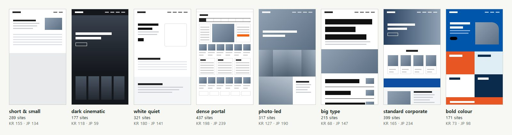

**2. 6 つの業種群。** 業種は、訪問者がそのサイトで行う目的に沿って分類しています。

| 業種群 | 業種 | 韓国 | 日本 |
|---|---|---|---|
| place | 宿泊、観光、飲食、ウェディング | 143 | 156 |
| care | 医院、病院、介護、美容、フィットネス | 175 | 259 |
| public | 行政、団体、大学、メディア、金融 | 202 | 179 |
| shop | EC、ファッション、化粧品、食品 | 199 | 165 |
| business | 製造、物流、ソフトウェア、建設、税務、採用 | 235 | 249 |
| creative | デザイン、ゲーム、建築、写真、イラスト | 130 | 234 |

**3. 14 種類のテーマ。** 各テーマは、特定の国・業種群でよく見られる類型をもとに仕上げたデザインで、サイズ・色・レイアウトを該当サイトの実測値から定めています。テーマに添えた件数は、その国の業種群で該当類型に属するサイト数です（たとえば `business-white` は韓国の `business` 235 件のうち 50 件にもとづいています）。国名は測定元を示すだけで、利用地域を制限するものではありません。韓国の医院が日本で測定したテーマを使うこともでき、`theme starter --lang` で組版をページの言語に合わせられます。

<!-- theme-grid:start (node scripts/build-theme-grid.mjs) -->
<table>
<tr>
<td align="center" valign="top" width="33%">
<a href="skills/ui-refiner-agent/reference/themes/place-photo-quiet/theme.md">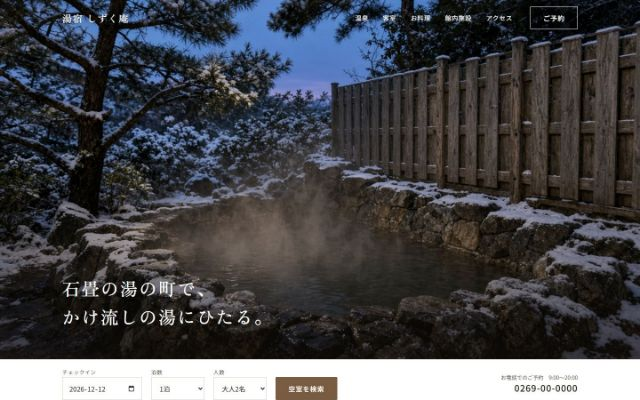</a><br>
<b><a href="skills/ui-refiner-agent/reference/themes/place-photo-quiet/theme.md">place-photo-quiet</a></b><br>
<sub>photo-led · 日本 65 件を実測</sub>
</td>
<td align="center" valign="top" width="33%">
<a href="skills/ui-refiner-agent/reference/themes/place-photo-view/theme.md">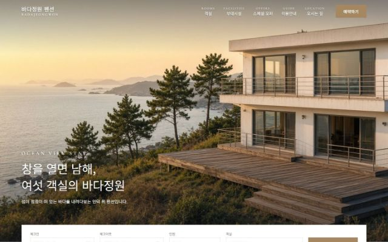</a><br>
<b><a href="skills/ui-refiner-agent/reference/themes/place-photo-view/theme.md">place-photo-view</a></b><br>
<sub>photo-led · 韓国 43 件を実測</sub>
</td>
<td align="center" valign="top" width="33%">
<a href="skills/ui-refiner-agent/reference/themes/care-white/theme.md">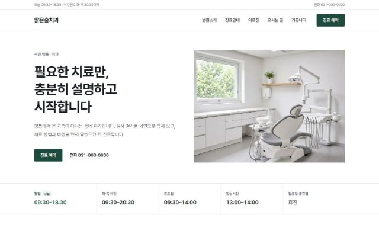</a><br>
<b><a href="skills/ui-refiner-agent/reference/themes/care-white/theme.md">care-white</a></b><br>
<sub>white quiet · 韓国 38 件を実測</sub>
</td>
</tr>
<tr>
<td align="center" valign="top" width="33%">
<a href="skills/ui-refiner-agent/reference/themes/care-corporate/theme.md">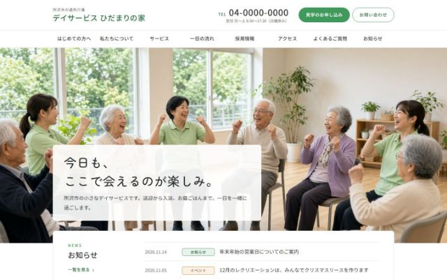</a><br>
<b><a href="skills/ui-refiner-agent/reference/themes/care-corporate/theme.md">care-corporate</a></b><br>
<sub>standard corporate · 日本 68 件を実測</sub>
</td>
<td align="center" valign="top" width="33%">
<a href="skills/ui-refiner-agent/reference/themes/business-dark/theme.md">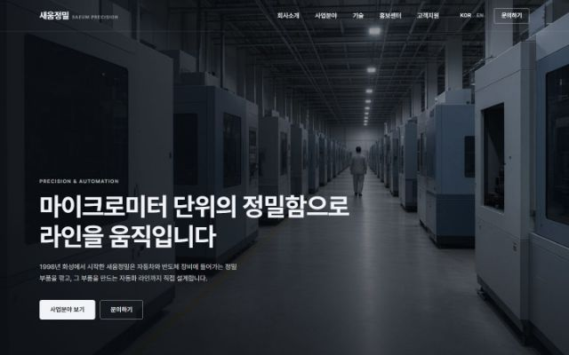</a><br>
<b><a href="skills/ui-refiner-agent/reference/themes/business-dark/theme.md">business-dark</a></b><br>
<sub>dark cinematic · 韓国 35 件を実測</sub>
</td>
<td align="center" valign="top" width="33%">
<a href="skills/ui-refiner-agent/reference/themes/business-white/theme.md">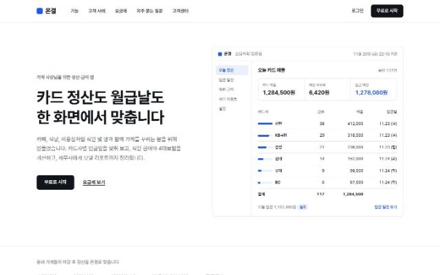</a><br>
<b><a href="skills/ui-refiner-agent/reference/themes/business-white/theme.md">business-white</a></b><br>
<sub>white quiet · 韓国 50 件を実測</sub>
</td>
</tr>
<tr>
<td align="center" valign="top" width="33%">
<a href="skills/ui-refiner-agent/reference/themes/business-corporate-quickbar/theme.md">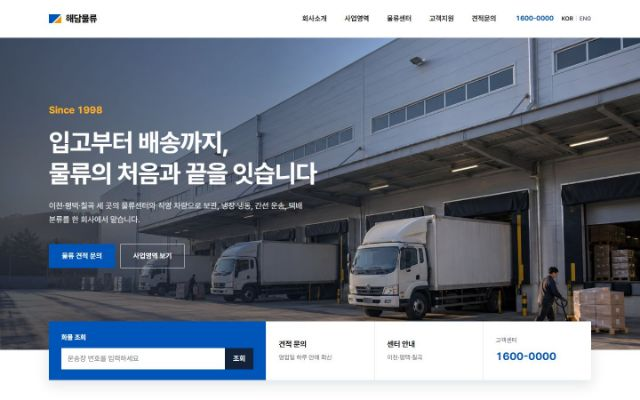</a><br>
<b><a href="skills/ui-refiner-agent/reference/themes/business-corporate-quickbar/theme.md">business-corporate-quickbar</a></b><br>
<sub>standard corporate · 韓国 41 件を実測</sub>
</td>
<td align="center" valign="top" width="33%">
<a href="skills/ui-refiner-agent/reference/themes/business-corporate-message/theme.md">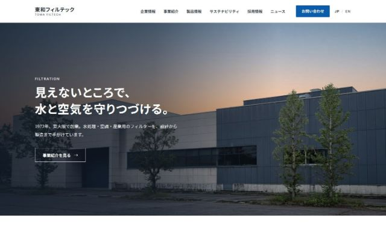</a><br>
<b><a href="skills/ui-refiner-agent/reference/themes/business-corporate-message/theme.md">business-corporate-message</a></b><br>
<sub>standard corporate · 日本 52 件を実測</sub>
</td>
<td align="center" valign="top" width="33%">
<a href="skills/ui-refiner-agent/reference/themes/public-portal-search/theme.md"></a><br>
<b><a href="skills/ui-refiner-agent/reference/themes/public-portal-search/theme.md">public-portal-search</a></b><br>
<sub>dense portal · 韓国 61 件を実測</sub>
</td>
</tr>
<tr>
<td align="center" valign="top" width="33%">
<a href="skills/ui-refiner-agent/reference/themes/public-portal-purpose/theme.md">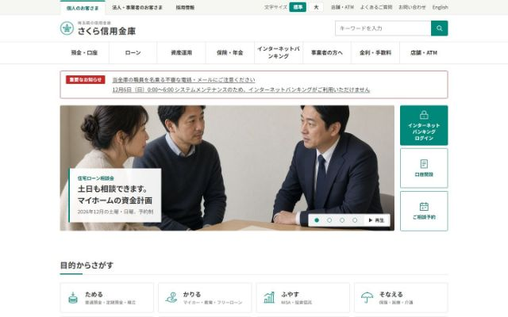</a><br>
<b><a href="skills/ui-refiner-agent/reference/themes/public-portal-purpose/theme.md">public-portal-purpose</a></b><br>
<sub>dense portal · 日本 64 件を実測</sub>
</td>
<td align="center" valign="top" width="33%">
<a href="skills/ui-refiner-agent/reference/themes/shop-portal-grid/theme.md">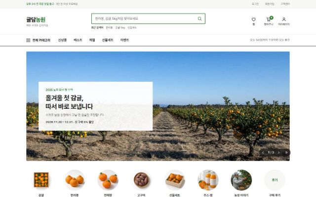</a><br>
<b><a href="skills/ui-refiner-agent/reference/themes/shop-portal-grid/theme.md">shop-portal-grid</a></b><br>
<sub>dense portal · 韓国 60 件を実測</sub>
</td>
<td align="center" valign="top" width="33%">
<a href="skills/ui-refiner-agent/reference/themes/shop-portal-story/theme.md">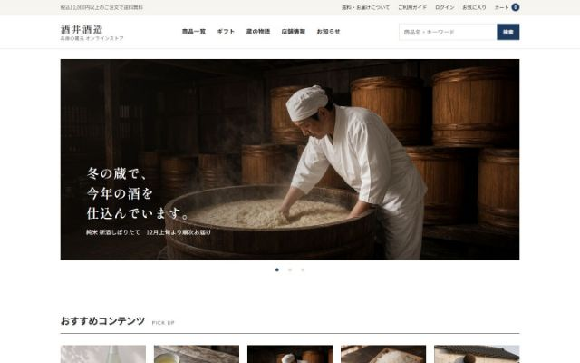</a><br>
<b><a href="skills/ui-refiner-agent/reference/themes/shop-portal-story/theme.md">shop-portal-story</a></b><br>
<sub>dense portal · 日本 57 件を実測</sub>
</td>
</tr>
<tr>
<td align="center" valign="top" width="33%">
<a href="skills/ui-refiner-agent/reference/themes/creative-dark/theme.md">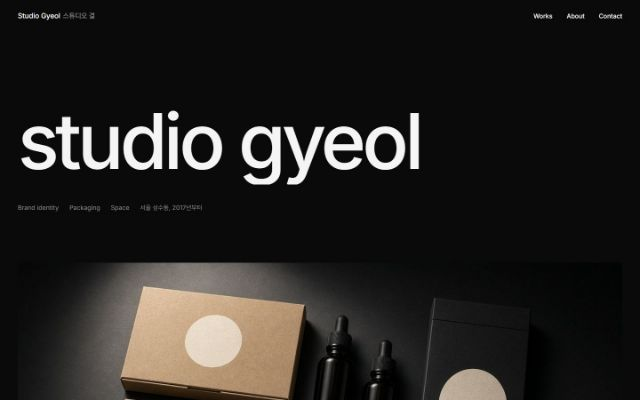</a><br>
<b><a href="skills/ui-refiner-agent/reference/themes/creative-dark/theme.md">creative-dark</a></b><br>
<sub>dark cinematic · 韓国 34 件を実測</sub>
</td>
<td align="center" valign="top" width="33%">
<a href="skills/ui-refiner-agent/reference/themes/creative-bigtype/theme.md">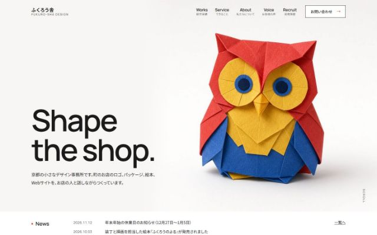</a><br>
<b><a href="skills/ui-refiner-agent/reference/themes/creative-bigtype/theme.md">creative-bigtype</a></b><br>
<sub>big type · 日本 36 件を実測</sub>
</td>
<td width="33%"></td>
</tr>
</table>
<!-- theme-grid:end -->

[テーマギャラリー](skills/ui-refiner-agent/reference/themes/GALLERY.md) · [測定方法とテーマ一覧](skills/ui-refiner-agent/reference/themes/README.md)

**4. 1 つの業種群を 8 種類の類型で比較する。** どの業種群も 8 種類の類型で設計できます。下の図は、韓国の `business` 業種群に属する架空の製造会社 1 社を 8 通りに描き分けたものです。8 類型のうち `dark cinematic`、`white quiet`、`standard corporate` の 3 つはテーマとして提供しています。残りの 5 つは各類型の実測値から作ったデモ用の見本であり、テーマとしては提供していません。件数は各組み合わせの多さを示しており、韓国の `business` サイトでは `white quiet` が 50 件、`bold colour` が 15 件です。

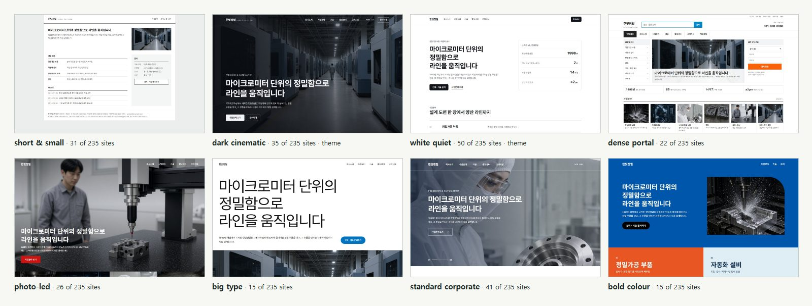

[デモページと実測数](docs/archetype-demo/README.md)

## クイックスタート

Node.js 22.18 以上、npm、Git が必要です。既存のアプリで使う場合は、アプリのルートディレクトリから実行してください。

```sh
git clone https://github.com/prentice7725/ui-refiner tools/ui-refiner
cd tools/ui-refiner
npm ci
npx playwright install chromium
node bin/ui-refiner.mjs doctor
node bin/ui-refiner.mjs scan examples/ai-slop-landing.html --lang ja
```

スキャンが終わったら `ui-refiner-scan/DESIGN_REVIEW.md` を開いてください。同じフォルダにデスクトップとモバイルのスクリーンショットも保存されます。サンプルの代わりに URL やローカル HTML のパスを指定すると、ご自身のページを点検できます。同じページを同じ出力先へ再スキャンすると、前回との比較結果が表示されます。

## エージェントで使う

上で開いた `tools/ui-refiner` ディレクトリで、お使いのツールに合ったコマンドを 1 つ実行してください。CLI のみを使う場合はこの手順を省略できます。

| ツール | インストール | 対象のアプリでの使い方 |
|---|---|---|
| Codex | `node scripts/install-agent-skill.mjs ../.. --host codex` | 新しいチャットで「landing.html のデザインを点検して」と依頼 |
| Claude Code | `node scripts/install-agent-skill.mjs ../.. --host claude` | 点検は `/ui-review landing.html`、修正は `/ui-refine landing.html` |

インストーラーをもう一度実行すると、現在のバージョンとファイルの差分を確認できます。`--update` を付けると更新可能なファイルを適用し、ローカルで変更されたファイルは確認対象として表示します。

<details>
<summary>Claude Code プラグインとしてインストール</summary>

Claude Code のチャットで次のコマンドを実行したあと、プラグインフォルダ内で `npm ci` と `npx playwright install chromium` を実行してください。

```text
/plugin marketplace add prentice7725/ui-refiner
/plugin install ui-refiner@ui-refiner
```

</details>

## 用途別の機能

- **既存ページの点検。** `scan` は検出したデザインパターンの根拠と改善案を提示します。0〜100 のスコアは検出パターンの強さを示し、文字のコントラストなどの品質項目は別に報告します。レポートは日本語・韓国語・英語に対応しており、`--lang ja` などで指定できます。
- **既存ページの修正。** 軽微な修正では既存の構成を保ち、全面的に見直す場合は韓国・日本の業種ページであれば合うテーマから始めます。それ以外のページや複数案を比較したい場合は、3 つの方向性から選べます。`keep check` でリンク・フォーム・数値が維持されているかを確かめ、`stress` で長い文言や大きな数値を入れてレイアウト崩れを検証できます。
- **新しいページの制作。** 韓国と日本のサイト 2,326 件の実測にもとづく 14 テーマを収録しています。ローカルのチェックアウトからギャラリーをブラウザで開くと、業種や写真の有無でサンプルを絞り込めます。`ui-refiner theme starter <theme> --brand "#rrggbb"` はテーマをプロジェクトへコピーしてブランドカラーを適用し、必要な写真とその色でコントラスト基準を満たさなくなる箇所を一覧表示します。`--lang` で組版言語を切り替えられるほか、3 つのテーマ（`care-white`、`place-photo-quiet`、`business-white`）では周囲と印象を変える任意のバリエーション（`--variant statement`）も利用できます。

3 ページを対象にした試行では、3 案から選ぶ手法がページ別の平均順位で 1 位でしたが、完成した 3 ページは互いに似ているという評価になりました。評価を行ったのは 1 つのモデルです。[試行結果](docs/refine-pilot-2026-11-15-local/results-five-arms.json)

[ガイドとプロジェクトの QA 設定](docs/GUIDE_JA.md) · [変更履歴](CHANGELOG.md) · [MIT](LICENSE) · [第三者ライセンス](licenses/THIRD_PARTY.md)
