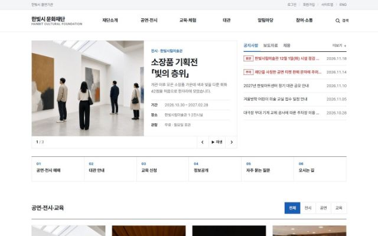

# UI Refiner

[English](README.md) · [한국어](README_KO.md) · [日本語](README_JA.md)

UI Refiner は、韓国・日本のサイト 2,326 件の実測をもとにしたウェブデザインテーマを 14 種類収録しています。Codex や Claude Code で業種に合うページを作成でき、CLI では既存のページを点検できます。

## テーマの作り方

**1. ページの類型は 8 種類。** 実測した 2,326 件は、全体の印象によって 8 種類に分かれます。図は類型ごとの実測平均(地の色、写真、文字サイズ、密度)を模式的に描いたものです。


**2. 業種群は 6 つ。** 業種は、訪問者がそのサイトで何をするかによってまとめています。

| 業種群 | 業種 | 韓国 | 日本 |
|---|---|---|---|
| place | 宿泊、観光、飲食、ウェディング | 143 | 156 |
| care | 医院、病院、介護、美容、フィットネス | 175 | 259 |
| public | 行政、団体、大学、メディア、金融 | 202 | 179 |
| shop | EC、ファッション、化粧品、食品 | 199 | 165 |
| business | 製造、物流、ソフトウェア、建設、税務、採用 | 235 | 249 |
| creative | デザイン、ゲーム、建築、写真、イラスト | 130 | 234 |

**3. テーマは 14 種類。** テーマは、ある国のある業種群に多い類型を仕上げたデザインです。サイズ、色、配置は、その類型に属するサイトの実測値から取っています。テーマに添えた数は、その国のその業種群で該当する類型に属するサイトの数です。`kr-business-white` は、韓国の business 235 件のうち 50 件を根拠にしています。

<!-- theme-grid:start (node scripts/build-theme-grid.mjs) -->
<table>
<tr>
<td align="center" valign="top" width="33%">
<a href="skills/ui-refiner-agent/reference/themes/kr-care-white/theme.md"></a><br>
<b><a href="skills/ui-refiner-agent/reference/themes/kr-care-white/theme.md">kr-care-white</a></b><br>
<sub>韓国 · care · white quiet ·&nbsp;38&nbsp;件</sub>
</td>
<td align="center" valign="top" width="33%">
<a href="skills/ui-refiner-agent/reference/themes/kr-business-dark/theme.md"></a><br>
<b><a href="skills/ui-refiner-agent/reference/themes/kr-business-dark/theme.md">kr-business-dark</a></b><br>
<sub>韓国 · business · dark cinematic ·&nbsp;35&nbsp;件</sub>
</td>
<td align="center" valign="top" width="33%">
<a href="skills/ui-refiner-agent/reference/themes/kr-business-white/theme.md"></a><br>
<b><a href="skills/ui-refiner-agent/reference/themes/kr-business-white/theme.md">kr-business-white</a></b><br>
<sub>韓国 · business · white quiet ·&nbsp;50&nbsp;件</sub>
</td>
</tr>
<tr>
<td align="center" valign="top" width="33%">
<a href="skills/ui-refiner-agent/reference/themes/kr-business-corporate/theme.md"></a><br>
<b><a href="skills/ui-refiner-agent/reference/themes/kr-business-corporate/theme.md">kr-business-corporate</a></b><br>
<sub>韓国 · business · standard corporate ·&nbsp;41&nbsp;件</sub>
</td>
<td align="center" valign="top" width="33%">
<a href="skills/ui-refiner-agent/reference/themes/kr-place-photo/theme.md"></a><br>
<b><a href="skills/ui-refiner-agent/reference/themes/kr-place-photo/theme.md">kr-place-photo</a></b><br>
<sub>韓国 · place · photo-led ·&nbsp;43&nbsp;件</sub>
</td>
<td align="center" valign="top" width="33%">
<a href="skills/ui-refiner-agent/reference/themes/kr-public-portal/theme.md"></a><br>
<b><a href="skills/ui-refiner-agent/reference/themes/kr-public-portal/theme.md">kr-public-portal</a></b><br>
<sub>韓国 · public · dense portal ·&nbsp;61&nbsp;件</sub>
</td>
</tr>
<tr>
<td align="center" valign="top" width="33%">
<a href="skills/ui-refiner-agent/reference/themes/kr-shop-portal/theme.md"></a><br>
<b><a href="skills/ui-refiner-agent/reference/themes/kr-shop-portal/theme.md">kr-shop-portal</a></b><br>
<sub>韓国 · shop · dense portal ·&nbsp;60&nbsp;件</sub>
</td>
<td align="center" valign="top" width="33%">
<a href="skills/ui-refiner-agent/reference/themes/kr-creative-dark/theme.md"></a><br>
<b><a href="skills/ui-refiner-agent/reference/themes/kr-creative-dark/theme.md">kr-creative-dark</a></b><br>
<sub>韓国 · creative · dark cinematic ·&nbsp;34&nbsp;件</sub>
</td>
<td align="center" valign="top" width="33%">
<a href="skills/ui-refiner-agent/reference/themes/jp-place-photo/theme.md"></a><br>
<b><a href="skills/ui-refiner-agent/reference/themes/jp-place-photo/theme.md">jp-place-photo</a></b><br>
<sub>日本 · place · photo-led ·&nbsp;65&nbsp;件</sub>
</td>
</tr>
<tr>
<td align="center" valign="top" width="33%">
<a href="skills/ui-refiner-agent/reference/themes/jp-care-corporate/theme.md"></a><br>
<b><a href="skills/ui-refiner-agent/reference/themes/jp-care-corporate/theme.md">jp-care-corporate</a></b><br>
<sub>日本 · care · standard corporate ·&nbsp;68&nbsp;件</sub>
</td>
<td align="center" valign="top" width="33%">
<a href="skills/ui-refiner-agent/reference/themes/jp-business-corporate/theme.md"></a><br>
<b><a href="skills/ui-refiner-agent/reference/themes/jp-business-corporate/theme.md">jp-business-corporate</a></b><br>
<sub>日本 · business · standard corporate ·&nbsp;52&nbsp;件</sub>
</td>
<td align="center" valign="top" width="33%">
<a href="skills/ui-refiner-agent/reference/themes/jp-public-portal/theme.md"></a><br>
<b><a href="skills/ui-refiner-agent/reference/themes/jp-public-portal/theme.md">jp-public-portal</a></b><br>
<sub>日本 · public · dense portal ·&nbsp;64&nbsp;件</sub>
</td>
</tr>
<tr>
<td align="center" valign="top" width="33%">
<a href="skills/ui-refiner-agent/reference/themes/jp-shop-portal/theme.md"></a><br>
<b><a href="skills/ui-refiner-agent/reference/themes/jp-shop-portal/theme.md">jp-shop-portal</a></b><br>
<sub>日本 · shop · dense portal ·&nbsp;57&nbsp;件</sub>
</td>
<td align="center" valign="top" width="33%">
<a href="skills/ui-refiner-agent/reference/themes/jp-creative-bigtype/theme.md"></a><br>
<b><a href="skills/ui-refiner-agent/reference/themes/jp-creative-bigtype/theme.md">jp-creative-bigtype</a></b><br>
<sub>日本 · creative · big type ·&nbsp;36&nbsp;件</sub>
</td>
<td width="33%"></td>
</tr>
</table>
<!-- theme-grid:end -->

[テーマギャラリー](skills/ui-refiner-agent/reference/themes/GALLERY.md) · [測定方法とテーマ一覧](skills/ui-refiner-agent/reference/themes/README.md)

**4. 一つの業種群を 8 種類の類型で。** どの業種群も 8 種類の類型で描けます。下の図は、韓国の business 業種群の架空の製造会社 1 社を 8 通りに描いたものです。このうち二つはテーマです。残りの六つは各類型の実測値から作ったデモ用サンプルで、テーマとしては提供していません。数は、その組み合わせがどれだけ多いかを示します。韓国の business サイトのうち white quiet は 50 件、bold colour は 15 件です。


[デモページと実測数](docs/archetype-demo/README.md)

## クイックスタート

Node.js 22.18 以上、npm、Git が必要です。既存のアプリで使う場合は、アプリのルートから実行します。

```sh
git clone https://github.com/prentice7725/ui-refiner tools/ui-refiner
cd tools/ui-refiner
npm ci
npx playwright install chromium
node bin/ui-refiner.mjs doctor
node bin/ui-refiner.mjs scan examples/ai-slop-landing.html --lang ja
```

実行後に `ui-refiner-scan/DESIGN_REVIEW.md` を開きます。同じフォルダにデスクトップとモバイルのスクリーンショットが保存されます。サンプルの代わりに URL やローカル HTML のパスを指定すると、自分のページを点検できます。同じページを同じ出力先に再スキャンすると前回の結果と比較できます。

## エージェントで使う

上の手順で開いた `tools/ui-refiner` で、使うツールに合ったコマンドを一つ実行してください。CLI だけを使う場合はこの手順を省略できます。

| ツール | インストール | 対象のアプリでの使い方 |
|---|---|---|
| Codex | `node scripts/install-agent-skill.mjs ../.. --host codex` | 新しいチャットで「landing.html のデザインを点検して」と依頼 |
| Claude Code | `node scripts/install-agent-skill.mjs ../.. --host claude` | 点検は `/ui-review landing.html`、修正は `/ui-refine landing.html` |

インストーラーを再実行するとバージョンとファイルの差分が表示されます。`--update` を付けると更新できるファイルを適用し、ローカルで編集したファイルは個別に表示します。

<details>
<summary>Claude Code プラグインとしてインストール</summary>

Claude Code のチャットで次のコマンドを実行し、プラグインのフォルダで `npm ci` と `npx playwright install chromium` を実行します。

```text
/plugin marketplace add prentice7725/ui-refiner
/plugin install ui-refiner@ui-refiner
```

</details>

## 用途別の機能

- **既存ページの点検。** `scan` は検出したデザインパターンの根拠と修正案を示します。0〜100 のスコアは検出したパターンの強さを表します。文字のコントラストなどの品質項目は別に報告します。レポートは日本語・韓国語・英語に対応し、`--lang ja` などで指定できます。
- **既存ページの修正。** 小さな修正では構成を維持し、全面的に見直す場合、韓国・日本の業種ページは合うテーマから始めます。それ以外のページや複数案を求められた場合は、三つの案から選びます。`keep check` でリンク・フォーム・数値が保たれたか、`stress` で長い文言や大きな数値がレイアウトを崩さないかを確認できます。
- **新しいページの制作。** 韓国・日本のサイト 2,326 件の実測をもとにした 14 テーマを収録しています。ローカルのギャラリーをブラウザで開くと、国・業種・写真の有無でサンプルを絞り込めます。

3 ページを対象にした試行では、三つの案から選ぶ手法がページ別の平均順位で首位でした。一方、完成した 3 ページは互いに似ていると評価されました。評価に使ったモデルは一つです。 [試行結果](docs/refine-pilot-2026-11-15-local/results-five-arms.json)

[ガイドとプロジェクトの QA 設定](docs/GUIDE_JA.md) · [変更履歴](CHANGELOG.md) · [MIT](LICENSE) · [第三者ライセンス](licenses/THIRD_PARTY.md)
