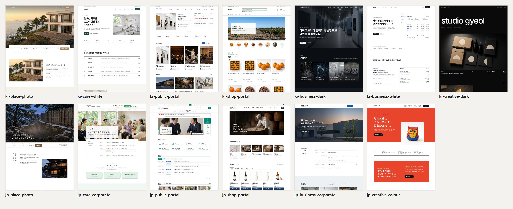

# UI Refiner

Claude Code와 Codex용 디자인 도구로, 실제 사이트를 잰 실측 위에 서 있습니다. 2026년 11월에 사람이 만든 한국·일본 사이트 2245곳을 재서 첫인상과, 방문자가 무엇을 하러 오는지로 묶었습니다. 그 묶음에서 완성된 테마 13개가 나왔습니다. 그래서 에이전트는 자기 습관이 아니라 같은 종류의 실제 사이트 모습에서 페이지를 시작합니다. AI가 만든 티가 나는 곳을 찾는 스캔과, 링크·폼·숫자를 그대로 지키며 페이지를 고치는 기능도 그대로 있습니다.

모델이 페이지를 잘 만들게 되면서 "AI가 만들었나"는 달마다 덜 중요해지고 있습니다. 여전히 틀리는 것은, 모델이 만든 페이지끼리 서로 닮고 정작 그 업종답지 않다는 점입니다. 그래서 이번 버전은 실측한 디자인을 앞에 두고, 스캔은 검사로 남깁니다.

[English](README.md) · [日本語](README_JA.md) · [설치](#설치) · [테마](skills/ui-refiner-agent/reference/themes/README.md) · [전체 가이드](docs/GUIDE_KO.md) · [변경 기록](CHANGELOG.md)

## 실측해서 만든 테마



- **어떻게 쟀는지.** 사이트마다 저장된 스캔과 데스크톱 스크린샷에서 특징 23개를 뽑았습니다. 첫 화면들에서 흰색, 어두운색, 사진, 짙은 색이 차지하는 비율, 글자 크기, 콘텐츠 폭, 페이지 길이, 가는 선 등입니다. 이것을 묶어 인상 여덟 가지를 얻었습니다: 짧고 작은, 어두운 영화풍, 하얀 여백, 촘촘한 포털, 사진 주도, 큰 글자, 표준 기업형, 짙은 색. 그다음 업종을 방문자가 하러 오는 일로 묶었습니다: 장소(묵고 먹고 보기), 진료·관리(예약하고 방문하기), 공공(찾아보고 신청하기), 쇼핑(고르고 사기), 기업(회사를 믿기), 창작(작업 보기).
- **묶음과 나라마다 테마 하나.** 테마는 한 나라 한 묶음에서 가장 흔한 인상이고, 값은 그 그룹의 실측에서 가져왔습니다: 바탕, 서체, 크기, 버튼 색과 모양, 콘텐츠 폭, 페이지 길이, 섹션 순서.
  - 한국과 일본은 업종만큼이나 다릅니다. 한국 진료 사이트는 하얗고 짧고, 일본은 표준 기업형입니다. 그래서 두 나라가 테마를 같이 쓰지 않습니다.
  - 한국 기업은 테마가 둘입니다. 고객 사진이 있으면 어두운 테마, 없으면 하얀 테마입니다.
- **테마마다 들어 있는 것.**
  - `theme.md`: 실측 근거(p25, 중앙값, p75), 토큰, 순서대로 놓인 섹션 뼈대, 업종 고유 요소, 규칙, 피할 것.
  - `theme.css`와 가상 고객의 샘플 페이지(제주 산지 직송 쇼핑몰, 교토 디자인 사무소 등), 데스크톱·휴대폰 스크린샷. 샘플은 모두 `stress`를 통과합니다.
  - Grok Imagine과 Codex로 만든 생성 사진과 그 프롬프트. 페이지에는 `data-generated`로 표시하고, 푸터에 예시라고 밝힙니다.
- **고객에게 적용하기.** 테마를 고르는 법과 실제 내용을 얹는 법은 [테마 README](skills/ui-refiner-agent/reference/themes/README.md)에 있습니다.
  - 사진 주도와 어두운 테마는 고객 자신의 사진이 있어야 합니다. 사진이 없는 물류 페이지에 어두운 테마를 입혔더니 어두운 글자 템플릿처럼 보였습니다.
  - 고객의 메뉴는 그대로 두고, 고객에게 내용이 없는 섹션은 빼고, 소식·숫자·후기를 지어내지 않습니다.
  - 결과에 `keep check`와 `stress`를 돌립니다.
  - 일본 료칸, 한국 치과, 한국 물류 회사, 실제 페이지 세 개에서 이 방법이 통했습니다.
- **한계.** 한국·일본 창작 테마는 근거가 12곳, 7곳뿐입니다. 생성 사진이 모자라 실측 페이지 길이보다 짧은 샘플이 있습니다. 테마는 한국·일본 사이트만 다룹니다.

## 그 밖에 할 수 있는 것

- **방향 세 개를 배정해서 고치기.** `/ui-refine`은 디자인을 모델의 습관에 맡기지 않습니다.
  - 첫 화면 시안 세 개를 서로 다른 출발점에서, 각각 다른 서브에이전트가 만듭니다: 익숙한 안(사람이 만든 같은 종류의 사이트 실측), 맞춤 안(이 고객의 내용에서 색과 서체까지 정함), 과감한 안(재료 하나로 끝까지).
  - 하나를 고르거나 섞으면, 실제 콘텐츠로 만든 고유 요소를 중심으로 페이지를 다시 짭니다. 예를 들면 가계부 앱의 이번 달 장부, 채용 페이지의 팀의 하루입니다.
  - 고객 사진이 없으면 `ui-refiner photos`가 위키미디어 공용에서 공개 라이선스 임시 사진을 출처와 함께 받아, 세 가지 폭의 WebP와 바로 쓸 수 있는 `` 줄로 만들어 줍니다.
  - 고객의 업종을 주면(`--trade inn`) 익숙한 안을 그 업종의 실측 첫 화면에서 뽑습니다. 일본 숙소 61곳은 69%가 첫 화면을 사진으로 꽉 채우고, 3분의 1이 제목에 명조체를 씁니다.
- **기억하기 때문에 고객마다 같은 페이지가 나오지 않습니다.**
  - 사용자 단위 기록에 고객마다 고른 방향을 남기고, 다음 배정은 그 모습을 피합니다. 고르지 않은 두 방향과, `--said`로 준 사람의 원래 말도 함께 남깁니다.
  - `ui-refiner prefer add surface paper --said "크림 바탕은 이제 그만"`처럼 싫은 것을 기록하면, 그 뒤의 배정은 세 방향 모두에서 그것을 뺍니다. 기록에는 사람의 원래 말이 있어야 하고, 한 종류의 페이지에만 적용되게 할 수도 있습니다. "피하기"만 있고 "선호하기"는 없습니다. 한 사람의 취향이 모든 고객을 한 모습으로 끌고 가지 않게 하려는 것입니다.
- **고치기가 정직하도록 막는 검사.**
  - `keep check`는 링크, 폼 필드, 숫자가 사라지거나 바뀌면 실패합니다. 검사 없이 고쳤을 때 409,847이 420,000으로 바뀐 적이 있습니다.
  - `directions verify`는 페이지가 고른 구조, 바탕, 서체에서 벗어나거나, 첫 화면에 한 줄 소개·주요 버튼·사진이나 큰 제품 화면이 없을 때 실패합니다. 웹폰트 CSS가 첫 화면 표시를 막거나 임시 사진에 `srcset`이 없을 때도 실패합니다.
  - `stress`는 화면에 그려진 글자에 현실적인 최악의 값을 넣고 320, 390, 1440px에서 봅니다. 더 긴 버튼 라벨, 제목 뒤에 붙는 두 번째 구절, 긴 이메일과 내선이 붙은 전화번호, 큰 숫자입니다. 그 값 때문에 새로 깨진 것만, 보통 고치는 CSS와 함께 알려 줍니다.
  - `system extract`는 고른 메인 페이지의 디자인을 `DESIGN_SYSTEM.md`로 저장하고, `system check`는 사이트의 다른 페이지가 그 디자인에서 벗어나면 실패합니다.
  - 마무리 게이트(Stop 훅)가 검사를 통과할 때까지 에이전트가 끝내지 못하게 합니다.
- **왜 뻔해 보이는지 말해 주는 스캔.**
  - `ui-refiner scan <url | 파일>`은 설정 없이 돌아갑니다.
  - 렌더링된 화면에서 스무 가지 남짓한 신호를 봅니다. 보라색 그라데이션, 아이콘 카드 그리드, 알약 모양 라벨, 유리 효과, 영어·한국어·일본어의 상투적인 문구, 세리프 제목을 얹은 크림 바탕 등입니다. 신호마다 근거, 뻔해 보이는 이유, 수정 방향이 붙습니다. 페이지에 남은 자리표시 글자와 Vercel 인터페이스 규칙 세 가지는 품질 항목으로 알려 줍니다.
  - AI가 만든 사이트와 사람이 만든 사이트 약 250곳으로 맞췄고, 사람이 만든 한국·일본 사이트 1790곳으로 확인했습니다. 20점 이상을 기준으로 AI 사이트의 69–74%를 잡고, 사람 사이트는 영어권 0–9%, 한국 7%, 일본 3%가 걸립니다. Claude와 Codex가 한 줄 요청으로 만든 한국어·일본어 페이지 79개에서는 73%를 잡습니다. Claude 페이지는 81%, Codex 페이지는 64%입니다.
  - 스크린샷을 채점한 시험지처럼 표시한 이미지(`scan-graded.png`)도 저장하고, 다시 스캔하면 전후 비교부터 보여 줍니다.
- **일본어 페이지는 실제 일본 사이트 209곳 사이에 놓고 봅니다.**
  - 조판 검사: 일본어 글꼴 누락, 좁은 행간, 제목의 한 글자 넘김(泣き別れ), 어색한 줄바꿈, 가짜 이탤릭.
  - 항목마다 위치를 보여 주므로 "행간 1.3"이 "일본 사이트 99%보다 좁음"으로 읽힙니다.

## 리파인을 같은 페이지로 잰 결과


벤치마크 페이지 3개를 Claude가 처음 만든 그대로(왼쪽)와, 세 방향 refine을 적용한 뒤(오른쪽)입니다. 사람이 고르는 자리에서는 에이전트가 대신 골랐습니다. 병원 사진은 출처를 밝힌 임시 사진입니다. 빨간 표시는 스캔이 직접 그린 채점본(`scan-graded.png`)입니다. 원본은 52, 43, 56점이고 고친 페이지는 0점입니다. refine은 자기 스캔에 걸리는 것이 없을 때까지 고치므로 0점은 당연한 결과입니다. 목록에 있는 신호가 사라졌다는 뜻이지, 디자인이 좋다는 뜻은 아닙니다.

| 한국어·일본어 3페이지, 각 1회 실행 | 17회차 | 12회차 | 재료만 | 재료(색·서체 자유) | 세 방향 |
|---|---:|---:|---:|---:|---:|
| 페이지별 평균 순위, 5개 중, 낮을수록 좋음 | 3.5 | 2.5 | 4.0 | 3.7 | **1.3** |
| 세트 유사도, 1–10, 낮을수록 다양함 | 5.0 | 5.0 | **3.5** | **3.5** | 7.0 |

- **페이지 하나씩 보면 세 방향 refine이 1위였습니다.** 평가 6번 중 4번입니다. 버전에 붙인 기호를 바꿔 페이지마다 두 번 평가했고, 세 페이지 모두 두 번 다 같은 버전이 이겼습니다.
- **세트로 보면 세 페이지가 가장 닮았습니다.** 에이전트가 맞춤 안을 두 번 골랐고, 평가자는 세 페이지 모두에서 작은 라벨, 왼쪽의 두꺼운 제목, 가짜 제품 카드, 숫자 줄을 보았습니다.
- **한계:** 3페이지, 각 1회 실행, 평가자 하나(Claude), 사람 평가 없음. [점수](docs/refine-pilot-2026-11-15-local/results-five-arms.json)

새 검사로 달라진 것입니다. 이번 릴리스의 스킬로 한국어·일본어 페이지 3개를 한 번씩 고쳤습니다(2026년 11월, $19.88).

| | 이전 refine | 이번 릴리스 |
|---|---:|---:|
| 첫 화면 표시를 막는 방식으로 웹폰트를 부른 페이지 | 6개 중 6 | 3개 중 0 |
| 임시 사진에 `srcset`이 없는 페이지 | 6개 중 5 | 3개 중 0 |
| 최종 페이지의 `stress` broken | 검사 안 함 | 3개 모두 0 (치과 원본은 1) |

세 번 모두 에이전트가 직접 `stress`를 돌렸습니다. 이전 시험에서 웹폰트를 막지 않게 부르는 것만으로 한 페이지의 Lighthouse 성능이 70에서 100이 됐습니다. 일본 병원 페이지에서는 `stress`가 처음에 아래 고정 바를 본문과 겹친다고 잘못 읽었고, 에이전트가 바를 고치다가 버튼 두 개가 잘리게 만들었습니다. `stress`가 그것을 잡았고 에이전트가 고쳤습니다. 잘못 읽은 부분은 이번 릴리스에서 고쳤습니다.

아직 효과가 없는 부분도 있습니다. 한국어·일본어 페이지 6개(36회, 시안만)에서 업종을 줘도 익숙한 안이 그 업종 실측에 더 가까워지지 않았습니다. 대부분의 업종이 페이지 종류의 기본 실측처럼 사진으로 시작하기 때문입니다. 0.7.0으로 8페이지를 돌렸을 때도 위와 같은 갈림이 나왔습니다. 세트로 보면 단순한 "AI 티 덜 나게" 요청이 8페이지를 모두 미색 바탕·세리프로 만든 반면 refine은 8가지 모습을 냈지만, 페이지 하나씩 보면 평가자는 여전히 단순 요청을 더 높게 봤습니다. [전체 회차와 한계](docs/REFINE_BENCHMARK_2026-11-08.md)

## 설치

필요한 것: Node.js 22.18+, npm, Git.

**Claude Code 플러그인.** 채팅창에 입력합니다.

```text
/plugin marketplace add prentice7725/ui-refiner
/plugin install ui-refiner@ui-refiner
```

그다음 플러그인 폴더에서 한 번:

```bash
npm ci && npx playwright install chromium
```

**프로젝트별 설치 (Claude Code, Codex).** 이 저장소를 앱의 `tools/ui-refiner`에 두고 실행합니다.

```bash
node tools/ui-refiner/scripts/install-agent-skill.mjs .
```

스킬, `/ui-review`와 `/ui-refine` 명령, 편집 후 훅, 마무리 게이트를 설치합니다.

**CLI만:**

```bash
git clone https://github.com/prentice7725/ui-refiner && cd ui-refiner
npm ci && npx playwright install chromium && npm link
ui-refiner scan your-site.example
```

[모든 명령과 옵션](docs/GUIDE_KO.md#빠른-시작)

## 써 보기

설치한 뒤 에이전트에게 평소 말로 부탁하거나 슬래시 명령을 씁니다.

```text
/ui-review https://example.co.kr
/ui-refine landing.html
```

> 하코네에 있는 우리 료칸 홈페이지를 jp-place-photo 테마로 만들어 줘. 사진은 ./photos에 있어.

> localhost:5173에 있는 랜딩 페이지 디자인 점검해 줘. 어디가 AI가 만든 티가 나는지 알려 줘.

> landing.html을 AI 티 안 나게 고쳐 줘. 가격과 링크는 전부 그대로 둬.

고치기를 부탁하면 에이전트는:
1. 페이지를 스캔하고 지켜야 할 것을 기록합니다.
2. 익숙한 안, 맞춤 안, 과감한 안을 각각 다른 서브에이전트가 만들고, 나란히 보여 준 뒤(`refine-directions/DIRECTIONS.html`) 고를 때까지 기다립니다.
3. 페이지를 다시 짜고, `keep check`, `directions verify`, `stress`를 돌린 뒤 다시 스캔합니다.

고른 뒤에 "조금 더 과감하게"나 "가격 섹션만 더 차분하게"라고 하면, 새로 만들지 않고 그 페이지가 이미 가진 서체·색·요소의 강도만 조절합니다. "크림 바탕은 이제 그만"처럼 무언가를 아예 빼고 싶다고 하면, 에이전트가 모든 고객에 해당하는지 묻고 기록합니다.

리포트는 페이지 언어(영어, 한국어, 일본어)를 따릅니다.

## 더 보기

- [테마](skills/ui-refiner-agent/reference/themes/README.md): 테마를 잰 방법, 고르는 법, 적용하는 법.
- [전체 가이드](docs/GUIDE_KO.md): `scan` 결과물, 모든 AI 티 신호, 일본어 검사, 보정, 에이전트 작업 흐름, 선택형 심화 QA 게이트와 한계.
- [Refine 벤치마크](docs/REFINE_BENCHMARK_2026-11-08.md): 1–11회차와 평가 메모.
- [변경 기록](CHANGELOG.md)

[](https://github.com/prentice7725/ui-refiner/actions/workflows/ci.yml)


[](LICENSE)

## 라이선스

MIT. 함께 들어 있는 외부 코드와 데이터는 각자의 라이선스를 따릅니다.
- suta: [vendor/suta/LICENSE](vendor/suta/LICENSE)
- lintapple: [vendor/lintapple/LICENSE](vendor/lintapple/LICENSE)
- UI UX Pro Max 데이터셋: [knowledge/ui-ux-pro-max/LICENSE](knowledge/ui-ux-pro-max/LICENSE)
- npm 패키지: [licenses/THIRD_PARTY.md](licenses/THIRD_PARTY.md)
