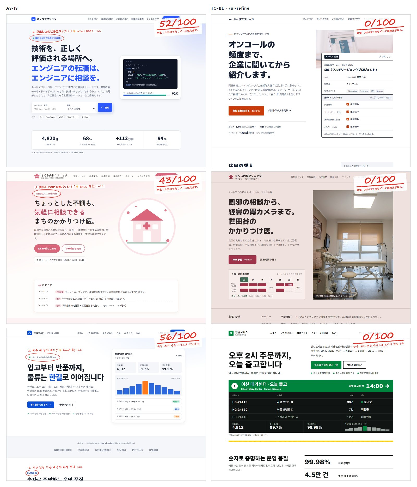

# UI Refiner

Claude Code와 Codex용 디자인 도구입니다. 에이전트가 만든 페이지가 AI가 만든 것처럼, 그리고 서로 비슷하게 보이지 않도록 돕습니다. 실제 브라우저로 페이지를 렌더링해 얼마나 뻔해 보이는지 점수를 매깁니다. 그다음 서로 다른 디자인 방향 세 개를 시안으로 만들어 고르게 하고, 고른 방향으로 페이지를 다시 짭니다. 링크, 폼, 숫자는 그대로 지킵니다.

[English](README.md) · [日本語](README_JA.md) · [설치](#설치) · [전체 가이드](docs/GUIDE_KO.md) · [변경 기록](CHANGELOG.md)

## 할 수 있는 것

- **방향 세 개를 배정해서 고치기.** `/ui-refine`은 디자인을 모델의 습관에 맡기지 않습니다.
  - 첫 화면 시안 세 개를 서로 다른 출발점에서 만듭니다: 익숙한 안(사람이 만든 같은 종류의 사이트 실측), 맞춤 안(이 고객의 내용에서 색과 서체까지 정함), 과감한 안(재료 하나로 끝까지).
  - 익숙한 안은 실측을 따릅니다. 사람이 만든 사이트 406곳이 첫 화면을 어떻게 시작하는지, 548곳이 어떤 색을 쓰는지입니다. 한국어·일본어 페이지에서는 `--trade`로 고객의 업종을 주면 그 업종 사이트의 실측으로 좁힙니다(미용실, 숙소, 음식점, 병의원, 종합병원, 학원, 소프트웨어 회사, 제조사, 공공기관 등 40개 업종 1389곳).
  - 사용자 단위 기록이 있어 다음 고객에게 같은 페이지가 나오지 않습니다.
  - 하나를 고르거나 섞으면, 실제 콘텐츠로 만든 고유 요소를 중심으로 페이지를 다시 짭니다. 예를 들면 가계부 앱의 이번 달 장부, 채용 페이지의 팀의 하루입니다.
- **고치기가 정직하도록 막는 검사.**
  - `keep check`는 링크, 폼 필드, 숫자가 사라지거나 바뀌면 실패합니다. 검사 없이 고쳤을 때 409,847이 420,000으로 바뀐 적이 있습니다.
  - `directions verify`는 페이지가 고른 구조, 바탕, 서체에서 벗어나면 실패합니다. 첫 화면에 한 줄 소개, 주요 버튼, 사진이나 큰 제품 화면이 없을 때와 다른 글자가 소개 문구보다 훨씬 클 때도 실패합니다.
  - `system extract`는 고른 메인 페이지의 디자인(서체, 색, 버튼, 모서리, 폭)을 `DESIGN_SYSTEM.md`로 저장하고, `system check`는 사이트의 다른 페이지가 그 디자인에서 벗어나면 실패합니다. 시안은 고객마다 달라지고, 한 사이트의 페이지들은 한 디자인을 지킵니다.
  - 마무리 게이트(Stop 훅)가 둘 다 통과할 때까지 에이전트가 끝내지 못하게 합니다.
- **왜 뻔해 보이는지 말해 주는 스캔.**
  - `ui-refiner scan <url | 파일>`은 설정 없이 돌아갑니다.
  - 렌더링된 화면에서 스무 가지 남짓한 신호를 봅니다. 보라색 그라데이션, 아이콘 카드 그리드, 알약 모양 라벨, 유리 효과, 영어·한국어·일본어의 상투적인 문구 등입니다. 신호마다 근거, 뻔해 보이는 이유, 수정 방향이 붙습니다.
  - AI가 만든 사이트와 사람이 만든 사이트 약 250곳으로 맞췄습니다. 20점 이상을 기준으로 AI 사이트의 66–74%를 잡고, 사람 사이트는 0–15%가 걸립니다.
  - 스크린샷을 채점한 시험지처럼 표시한 이미지(`scan-graded.png`)도 저장합니다. 점수가 붙은 신호마다 발견된 자리에 빨간 동그라미와 점수를 적고, 맨 위에 총점을 씁니다.
  - 다시 스캔하면 전후 비교부터 보여 줍니다.
- **일본어 페이지는 실제 일본 사이트 209곳 사이에 놓고 봅니다.**
  - 조판 검사: 일본어 글꼴 누락, 좁은 행간, 제목의 한 글자 넘김(泣き別れ), 어색한 줄바꿈, 가짜 이탤릭.
  - 항목마다 위치를 보여 주므로 "행간 1.3"이 "일본 사이트 99%보다 좁음"으로 읽힙니다.

## 같은 페이지로 잰 결과



벤치마크 페이지 3개를 Claude가 처음 만든 그대로(왼쪽)와, 세 방향을 쓰는 현재 refine을 적용한 뒤(오른쪽, 미출시)입니다. 사람이 고르는 자리에서는 에이전트가 대신 골랐습니다. 병원 사진은 출처를 밝힌 임시 사진입니다. 빨간 표시는 스캔이 직접 그린 채점본(`scan-graded.png`)입니다. 점수가 붙은 신호마다 발견된 자리에 동그라미와 점수를 적고, 오른쪽 위에 AI 티 점수를 씁니다. 원본은 52, 43, 56점이고 고친 페이지는 0점입니다. refine은 자기 스캔에 걸리는 것이 없을 때까지 고치므로 0점은 당연한 결과입니다. 목록에 있는 신호가 사라졌다는 뜻이지, 디자인이 좋다는 뜻은 아닙니다.

| 한국어·일본어 3페이지, 각 1회 실행 | 17회차 | 12회차 | 재료만 | 세 방향 |
|---|---:|---:|---:|---:|
| 페이지별 평균 순위, 5개 중, 낮을수록 좋음 | 3.5 | 2.5 | 4.0 | **1.3** |
| 세트 유사도, 1–10, 낮을수록 다양함 | 5.0 | 5.0 | **3.5** | 7.0 |

- **페이지 하나씩 보면 세 방향 refine이 1위였습니다.** 평가 6번 중 4번이고, 글자 순서를 바꿔도 세 페이지 모두 같은 버전이 이겼습니다.
- **세트로 보면 세 페이지가 가장 닮았습니다.** 에이전트가 맞춤 안을 두 번 골랐고, 평가자는 세 페이지 모두에서 작은 라벨, 왼쪽의 두꺼운 제목, 가짜 제품 카드, 숫자 줄을 보았습니다.
- **한계:** 3페이지, 각 1회 실행, 평가자 하나(Claude, 글자 순서 2가지), 사람 평가 없음. [점수](docs/refine-pilot-2026-11-15-local/results-five-arms.json)

### 0.7.0, 8페이지

벤치마크는 Claude가 한 줄 프롬프트로 만든 페이지 8개입니다. 팀 협업 도구, 가계부 앱, 치과, 푸드뱅크, 일본 채용 페이지, 일본 병원, 한국 금융 앱, 한국 물류 사이트입니다. 페이지마다 Claude Code로 한 번씩 고쳤고, 평가는 버전 이름을 가린 채 Claude가 했습니다. 세트 평가는 한 버전의 8페이지를 한꺼번에 보고 서로 얼마나 닮았는지 매기고, 페이지 평가는 같은 페이지의 다섯 버전에 순위를 매깁니다.

| 8페이지, 각 1회 실행 | 원본 | "AI 티 덜 나게" 요청 | `/ui-refine` 0.7.0 | 실제 사람 사이트 |
|---|---:|---:|---:|---:|
| 세트 유사도, 1–10, 낮을수록 다양함 (2회) | 9 / 8 | 8 / 9 | **4 / 5** | 2 / 1 |
| 세트 순위, 8개 중 (2회) | 8 / 8 | 6 / 7 | **4 / 4** | 1 / 1 |
| 페이지별 평균 순위, 5개 중, 낮을수록 좋음 | 4.9 | **2.0** | 3.5 | — |
| 숫자를 잃거나 바꾼 페이지 | — | 검사 안 함 | 0 | — |

이 숫자가 말하는 것:
- **세트로 보면 효과가 있습니다.** 단순 요청은 8페이지를 모두 같은 미색 바탕·세리프 에디토리얼 템플릿으로 바꿨습니다. `/ui-refine`은 8페이지에 서로 다른 모습을 주었고, 모든 페이지 첫 화면에 사진이나 제품 화면이 들어갑니다. 세트 평가에서는 두 번 모두 단순 요청과 원본보다 앞섰지만, 실제 사람 사이트보다는 뒤였습니다.
- **페이지 하나씩 보면 아직 이기지 못합니다.** 페이지 평가는 여전히 단순 요청(2.0)과, 한 가지 강한 모습을 유지한 초기 refine(1.8)을 더 높게 봅니다. 둘 다 사진이 없으므로, 이미지만으로는 이 차이가 메워지지 않습니다.
- **세트 평가가 여전히 짚는 습관:** 두꺼운 그로테스크 제목, 요일별 운영시간 띠, 데이터 표 히어로, 숫자 통계 줄.
- **한계:** 8페이지, 버전마다 1회 실행, Claude가 Claude의 결과를 평가.

[방법, 11회차 전체, 한계](docs/REFINE_BENCHMARK_2026-11-08.md)

## 설치

필요한 것: Node.js 22.18+, npm, Git.

**Claude Code 플러그인.** 채팅창에 입력합니다.

```text
/plugin marketplace add prentice7725/ui-refiner
/plugin install ui-refiner@ui-refiner
```

그다음 플러그인 폴더에서 한 번:

```bash
npm ci && npx playwright install chromium
```

**프로젝트별 설치 (Claude Code, Codex).** 이 저장소를 앱의 `tools/ui-refiner`에 두고 실행합니다.

```bash
node tools/ui-refiner/scripts/install-agent-skill.mjs .
```

스킬, `/ui-review`와 `/ui-refine` 명령, 편집 후 훅, 마무리 게이트를 설치합니다.

**CLI만:**

```bash
git clone https://github.com/prentice7725/ui-refiner && cd ui-refiner
npm ci && npx playwright install chromium && npm link
ui-refiner scan your-site.example
```

[모든 명령과 옵션](docs/GUIDE_KO.md#빠른-시작)

## 써 보기

설치한 뒤 에이전트에게 평소 말로 부탁하거나 슬래시 명령을 씁니다.

```text
/ui-review https://example.co.kr
/ui-refine landing.html
```

> localhost:5173에 있는 랜딩 페이지 디자인 점검해 줘. 어디가 AI가 만든 티가 나는지 알려 줘.

> landing.html을 AI 티 안 나게 고쳐 줘. 가격과 링크는 전부 그대로 둬.

고치기를 부탁하면 에이전트는:
1. 페이지를 스캔하고 지켜야 할 것을 기록합니다.
2. 익숙한 안, 맞춤 안, 과감한 안을 각각 다른 서브에이전트가 만들고, 나란히 보여 준 뒤(`refine-directions/DIRECTIONS.html`) 고를 때까지 기다립니다.
3. 페이지를 다시 짜고, 검사한 뒤 다시 스캔합니다.

고른 뒤에 "조금 더 과감하게"나 "가격 섹션만 더 차분하게"라고 하면, 새로 만들지 않고 그 페이지가 이미 가진 서체·색·요소의 강도만 조절합니다.

리포트는 페이지 언어(영어, 한국어, 일본어)를 따릅니다.

## 더 보기

- [전체 가이드](docs/GUIDE_KO.md): `scan` 결과물, 모든 AI 티 신호, 일본어 검사, 보정, 에이전트 작업 흐름, 선택형 심화 QA 게이트와 한계.
- [Refine 벤치마크](docs/REFINE_BENCHMARK_2026-11-08.md): 1–11회차와 평가 메모.
- [변경 기록](CHANGELOG.md)

[](https://github.com/prentice7725/ui-refiner/actions/workflows/ci.yml)


[](LICENSE)

## 라이선스

MIT. 함께 들어 있는 외부 코드와 데이터는 각자의 라이선스를 따릅니다.
- suta: [vendor/suta/LICENSE](vendor/suta/LICENSE)
- lintapple: [vendor/lintapple/LICENSE](vendor/lintapple/LICENSE)
- UI UX Pro Max 데이터셋: [knowledge/ui-ux-pro-max/LICENSE](knowledge/ui-ux-pro-max/LICENSE)
- npm 패키지: [licenses/THIRD_PARTY.md](licenses/THIRD_PARTY.md)
