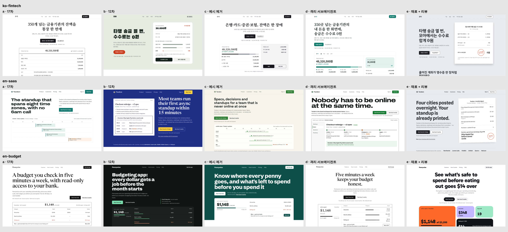
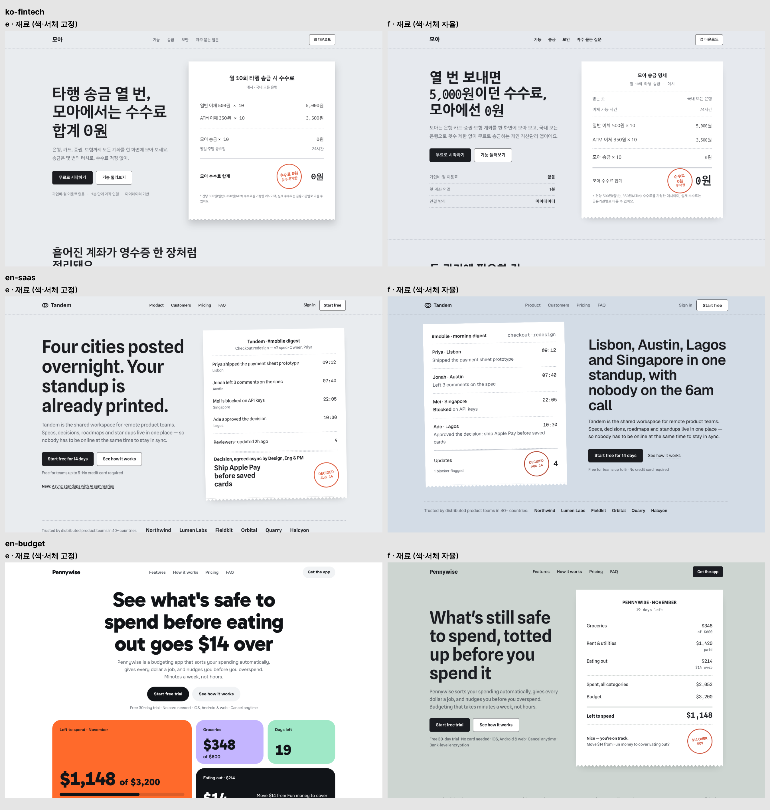
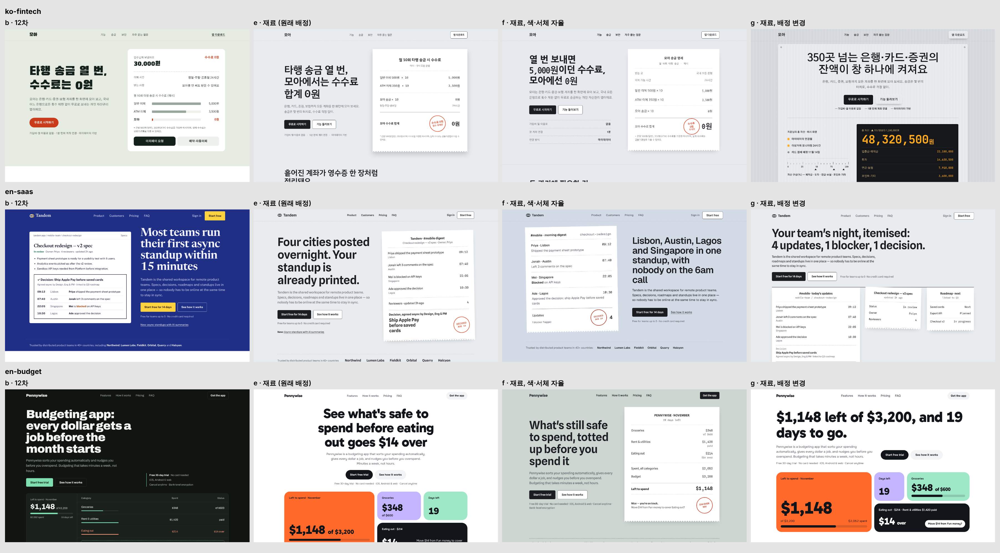

# 18차 파일럿 (클라우드 분): 소프트웨어 페이지 3개, 다섯 조건

2026-11-15 실행. 사진이 필요 없는 소프트웨어 페이지 3개(한국 가계부, 영어 협업 도구, 영어 가계부)에 다섯 조건을 **1회씩** 돌렸습니다. 클라우드 환경에서는 위키미디어 사진 검색이 429로 거절돼 사진이 주가 되는 페이지는 돌리지 않았습니다. 그쪽은 로컬에서 이어 갑니다([이어서 돌리기](#로컬에서-이어서-돌리기)).

결과물은 [`refine-pilot-2026-11-15/`](refine-pilot-2026-11-15/)에 있습니다: 조건별 최종 페이지, 첫 화면 모음(`first-screens.png`), 집계(`results.json`은 다섯 조건, `results-6arms.json`과 `results-7arms.json`은 뒤에 추가한 조건 f, g까지), 실행 기록(`runs.json`).



## 조건

| | 조건 | 기준 |
|---|---|---|
| a | 17차 그대로 | `main` (99ae8d0) |
| b | 12차: 구조와 바탕만 배정, 고객 사실로 쓴 제목 | de170f6 |
| c | 17차에서 고유 요소·세계·순간의 예시만 뺀 스킬 | 이 브랜치 |
| d | c + 시안 세 개를 서로 못 보는 서브에이전트가 따로 만든다 | 이 브랜치 + `variants/isolated.md` |
| e | 재료 배정 + 새 맥락의 히어로·마무리 리뷰 | `feat/refine-materials` (f4684f5) |

생성과 평가 모두 `claude-opus-5-5`입니다. 평가는 같은 비교를 글자 순서를 뒤집어 두 번 했습니다.

## 먼저 읽을 것: 이 결과로 순위를 정할 수 없습니다

- **조건마다 1회 실행**이라 한 조건이 반복 사이에 얼마나 흔들리는지 모릅니다.
- **순서를 뒤집었더니 1위가 같았던 비교는 3쌍 중 1쌍**입니다. 영어 가계부는 d → a로, 영어 협업 도구는 e → d로 1위가 바뀌었습니다. 낱장 순위 한 번은 믿을 수 없다는 뜻이고, 1–17차의 낱장 순위도 같은 한계가 있었을 것입니다.
- 평가자가 Claude 하나뿐이고, 생성 모델과 같습니다. 12차부터 쓰던 Gemini와 Grok은 이번에 없습니다.
- 세트 평가는 페이지 3개짜리입니다.

아래 숫자는 방향을 가늠하는 용도입니다.

## 숫자

| 조건 | 낱장 평균 순위 (5개 중) | 1위 | 개성 점수 | 세트 유사도 (10 = 한 템플릿) | 세트 순위 | 3페이지 비용 | 첫 화면 가는 선 |
|---|---|---|---|---|---|---|---|
| a 17차 | 3.5 | 1 | 5.8 | 8 | 5 | $5.31 | 12.3 |
| b 12차 | 2.7 | 2 | 7.0 | 3 | 1 | $5.61 | 8.0 |
| c 예시 제거 | 4.2 | 0 | 4.7 | 5 | 2 | $5.34 | 7.0 |
| d 격리 | 2.2 | 2 | 6.7 | 7 | 4 | $12.73 | 9.3 |
| e 재료 | 2.5 | 1 | 8.5 | 6 | 3 | $10.57 | 2.0 |

15회 모두 `keep check`를 통과했습니다. 평가 비용은 $8.96입니다.

## 순서가 바뀌어도 그대로였던 것

낱장 순위와 달리 아래는 두 순서의 평가에서 같게 나왔습니다.

1. **세트 순위는 두 번 모두 b > c > e > d > a였습니다.** 12차가 세 페이지를 가장 다르게 만들었고(연녹색, 짙은 파랑, 다크), 17차가 가장 한 템플릿 같았습니다. 12차와 17차를 같은 조건에서 나란히 돌린 것은 이번이 처음입니다.
2. **재료 조건은 3페이지 중 2페이지가 같은 재료(Receipt)를 골랐습니다.** 세트 평가자는 두 번 모두 "두 사이트가 같은 회색 바탕, 영수증 카드, 빨간 도장"이라고 적었습니다. 소프트웨어 페이지는 성격과 종류가 맞는 재료가 2–3개뿐입니다.
3. **재료 조건의 개성 점수가 가장 높았습니다(8.5).** 첫 화면의 가는 선도 2.0개로 가장 적습니다. 17차에서 지적된 "가는 선 격자"는 재료를 주면 사라집니다.
4. **한국 가계부는 조건과 상관없이 '통장'이었습니다.** a, c, d 모두 통장을 세계로 삼았습니다. d에서는 서로 못 보는 서브에이전트 세 개가 처음에 모두 같은 세계와 같은 서체(Hahmlet + Gothic A1)를 골랐습니다. 시안을 격리하는 것만으로는 출발점이 달라지지 않습니다.
5. **예시를 빼는 것만으로는 달라지지 않았습니다.** c는 세 페이지 모두 첫 화면에 표나 숫자 행 묶음이 있었고(a도 같음), 낱장으로는 가장 낮았습니다.

## 개성은 어디서 사라지는가

단계별 사본으로 처음 재 봤습니다. 평가자에게 같은 실행의 두 단계를 보여 주고 "어느 쪽 방향이 더 뚜렷한가"를 물었습니다(양쪽 순서 합산, 최종 / 앞 단계 / 같음).

| 조건 | 첫 구현 → 최종 | 고른 시안 → 최종 |
|---|---|---|
| a | 3 / 0 / 3 | 5 / 0 / 1 |
| b | 0 / 0 / 2 | 4 / 0 / 2 |
| c | 0 / 2 / 4 | 4 / 0 / 2 |
| d | 0 / 0 / 6 | 0 / 1 / 5 |
| e | 6 / 0 / 0 | 4 / 2 / 0 |

- **검사 뒤 수정이 방향을 흐리게 한 경우는 거의 없습니다.** 앞 단계가 더 뚜렷하다는 표는 전체 56표 중 5표입니다. "검증 루프가 개성을 깎는다"는 가설은 이 표본에서는 보이지 않습니다. 밋밋한 페이지는 시안 단계부터 밋밋했습니다.
- **재료 조건은 첫 구현 뒤에 6표 모두 최종본이 더 뚜렷해졌습니다.** 새 맥락 리뷰가 들어가는 구간입니다. 한국 가계부에서는 리뷰가 "경쟁사에도 맞는 제목"이라고 지적해 제목이 바뀌었습니다.

## 추가: 재료에서 색과 서체 고정을 풀면 (조건 f)

재료 조건(e)에 작은 패치(`scripts/refine-bench/variants/materials-free.patch`)를 얹었습니다. 재료 파일은 그대로 두고 읽는 규칙만 바꿔, 재료는 표면·컨트롤·조판 방식만 정하고 색과 서체는 에이전트가 고객에 맞춰 고르게 했습니다. 같은 3페이지에 1회씩 돌리고 여섯 조건을 다시 평가했습니다(`results-6arms.json`).



| 조건 | 낱장 평균 순위 (6개 중) | 개성 점수 | 세트 유사도 | 세트 순위 |
|---|---|---|---|---|
| a 17차 | 3.5 | 6.2 | 6.5 | 4 |
| b 12차 | 2.8 | 6.8 | 3.5 | 1 |
| c 예시 제거 | 5.5 | 4.5 | 5.0 | 2.5 |
| d 격리 | 3.0 | 6.5 | 5.0 | 2.5 |
| e 재료 | 3.2 | 7.3 | 7.0 | 5 |
| f 재료, 색·서체 자율 | 3.0 | 8.2 | 9.0 | 6 |

- **세트에서는 더 나빠졌습니다.** f는 세 페이지 모두 Receipt를 골랐고, 평가자는 두 번 모두 "세 히어로가 같은 디자인"이라고 적었습니다. 세트 순위는 두 번 모두 꼴찌입니다.
- **색은 거의 달라지지 않았습니다.** 세 페이지의 바탕은 회색, 청회색, 회녹색이고 도장은 모두 빨강입니다. 재료 파일 본문이 "회색 계산대", "빨간 도장"이라고 말하는 한 규칙으로 풀어도 에이전트는 그대로 따릅니다. 서체는 바뀌었습니다(나눔고딕, Geist, Spline Sans).
- **겹침의 원인은 색 고정이 아니라 재료 선택이었습니다.** 소프트웨어 페이지에 맞는 재료가 2–3개뿐이라 Receipt가 매번 배정되고, 에이전트는 세 번 모두 그것을 골랐습니다. 직전 프로젝트에서 고른 재료를 뒤로 미루는 규칙은 후보가 적을 때는 배정에서 빼 주지 못합니다.
- **낱장으로는 여전히 개성 점수가 가장 높습니다(8.2).** 재료가 개성을 만든다는 점은 e와 같습니다.
- **12차는 여섯 조건에서도 두 번 모두 세트 1위였습니다.**
- 이번 평가에서는 순서를 뒤집어도 1위가 같았던 비교가 3쌍 중 2쌍이었습니다.

정리하면, 재료는 낱장의 개성을 올리지만 지금 구조(재료 9개, 성격·종류로 거른 뒤 배정)로는 세트에서 겹칩니다. 색·서체를 푸는 것으로는 해결되지 않았습니다. 다음 후보는 재료 선택 쪽입니다: 최근에 고른 재료를 배정에서 아예 빼기, 소프트웨어용 재료 늘리기, 또는 재료를 성격·종류로 좁게 거르지 않기.

## 추가: 재료 배정만 바꾸면 (조건 g)

재료 조건(e)에서 배정 코드만 고쳤습니다(`scripts/refine-bench/variants/materials-deal.patch`). 최근 네 프로젝트에서 고른 재료는 배정에서 빼고, 성격과 종류 중 하나만 맞아도 후보에 넣습니다. 색과 서체는 e처럼 재료 파일대로입니다. 같은 3페이지에 1회씩 돌리고 일곱 조건을 다시 평가했습니다(`results-7arms.json`).



| 조건 | 낱장 평균 순위 (7개 중) | 개성 점수 | 세트 유사도 | 세트 순위 |
|---|---|---|---|---|
| a 17차 | 3.2 | 6.5 | 6.0 | 4.5 |
| b 12차 | 3.3 | 7.0 | 3.0 | 1 |
| c 예시 제거 | 5.0 | 5.0 | 5.5 | 4.5 |
| d 격리 | 2.7 | 6.3 | 4.5 | 3 |
| e 재료 | 4.7 | 6.8 | 7.0 | 6 |
| f 재료, 색·서체 자율 | 3.3 | 8.0 | 9.0 | 7 |
| g 재료, 배정 변경 | 5.8 | 6.8 | 4.0 | 2 |

- **세트 겹침은 풀렸습니다.** g는 세 페이지가 Panel, Receipt, Widget으로 갈렸고, 세트 유사도가 7.0(e)에서 4.0으로 내려가 두 번 모두 12차 다음인 2위였습니다. 겹침이 배정 문제였다는 것이 확인됐습니다.
- **낱장으로는 가장 낮았습니다(5.8).** 한국 가계부가 Panel(알루미늄 계기판, 어두운 화면에 노란 숫자)을 받아 두 번 모두 꼴찌였습니다. 후보를 넓히자 고객에 덜 맞는 재료가 배정됐고, 에이전트는 그 셋 중에서 골라야 했습니다. 일지의 "낱장 품질과 세트 다양성은 시소"가 재료에서도 그대로 나타났습니다.
- 이번 평가에서는 순서를 뒤집어도 1위가 세 쌍 모두 같았습니다.
- 세 번의 평가(다섯, 여섯, 일곱 조건)에서 12차는 매번 세트 1위였습니다. 낱장 순위는 평가마다 조건의 자리가 바뀌어(e는 2.5 → 3.2 → 4.7) 1회 실행으로는 읽을 수 없습니다.

## 여기까지의 정리

| 질문 | 이 표본에서 본 것 |
|---|---|
| 고유 요소 예시를 빼면 달라지는가 | 아니오 (c) |
| 시안을 서로 못 보게 하면 달라지는가 | 아니오. 처음 세 시안이 같은 세계와 서체를 골랐다 (d) |
| 검사 뒤 수정이 개성을 깎는가 | 거의 아니오. 밋밋한 페이지는 시안부터 밋밋했다 |
| 재료는 개성을 올리는가 | 예 (e, f의 개성 점수) |
| 재료의 색·서체를 풀면 세트에서 달라 보이는가 | 아니오. 오히려 같은 재료로 더 모였다 (f) |
| 재료를 겹치지 않게 배정하면 세트가 달라지는가 | 예. 대신 고객에 덜 맞는 재료가 나와 낱장이 떨어졌다 (g) |
| 17차보다 12차가 세트에서 나은가 | 예. 세 번의 평가 모두 |

남은 문제는 "고객에 맞으면서 서로 겹치지 않는" 재료를 어떻게 주느냐입니다. 재료가 9개인 한 맞는 것과 안 겹치는 것을 함께 얻기 어렵습니다. 후보는 재료 수를 늘리는 것, 또는 12차처럼 에이전트가 고객 내용에서 스스로 정하게 하고 재료는 "만드는 법"의 참고로만 주는 것입니다.

## 다음에 확인할 것

- 사진이 주가 되는 페이지에서도 같은 경향인지 (로컬).
- 반복 2–3회차로 흔들림 폭 재기. 지금은 낱장 순위 차이를 해석할 수 없습니다.
- 재료가 겹치지 않게 배정하면 세트 유사도가 내려가는지 (위 조건 f 참고: 색·서체를 푸는 것으로는 내려가지 않았습니다).
- 12차의 무엇이 세트를 다르게 만드는지. 12차는 색과 서체를 에이전트에게 맡깁니다.

## 로컬에서 이어서 돌리기

```bash
git fetch origin && git switch claude/epic-volta-9yak5f && npm ci
node bin/ui-refiner.mjs photos "dental chair" --out /tmp/photo-test   # 사진 검색이 되는지 먼저 확인
export BENCH_DIR=~/refine-pilot
H=scripts/refine-bench
PAGES="en-dental en-foodbank ja-recruit ja-clinic ko-logistics" REPS="1" ARMS="a b c d e" $H/pilot.sh   # 조건 f, g도 보려면 ARMS에 추가
ARMS=refine-a,refine-b,refine-c,refine-d,refine-e REPS=1 ORDERS=2 STAGES=1 node $H/judge-prep.cjs
$H/judge.sh && node $H/agg.cjs
```

- 1회차는 25회 실행으로, 이번 단가로 약 $65에 평가 비용이 더해집니다. d와 e가 다른 조건의 두 배쯤 듭니다.
- 중단돼도 `pilot.sh`를 다시 돌리면 끝난 실행은 건너뜁니다. 반복을 늘리려면 `REPS="1 2 3"`으로 다시 돌립니다.
- 클라우드 실행과 합쳐 보려면 `$BENCH_DIR/results.json`을 이 폴더의 `results.json`과 나란히 두면 됩니다. 페이지가 겹치지 않아 그대로 이어 붙일 수 있습니다.
