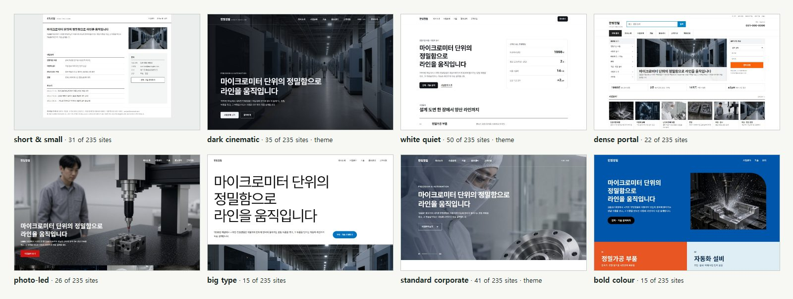

# One family in all eight types

The 14 themes cover one or two page types per trade family and country. These pages show that a family can be drawn in every type: the Korean business family, for one fictional maker (한빛정밀, the client of the `kr-business-dark` sample), with the same content and photographs in each.



| Type | Korean business sites | Page | Status |
|---|---|---|---|
| short & small | 31 | [short.html](kr-business/short.html) | demonstration |
| dark cinematic | 35 | [kr-business-dark sample](../../skills/ui-refiner-agent/reference/themes/kr-business-dark/sample.html) | theme |
| white quiet | 50 | [white.html](kr-business/white.html) | demonstration; the theme is [kr-business-white](../../skills/ui-refiner-agent/reference/themes/kr-business-white/theme.md) |
| dense portal | 22 | [portal.html](kr-business/portal.html) | demonstration |
| photo-led | 26 | [photo.html](kr-business/photo.html) | demonstration |
| big type | 15 | [bigtype.html](kr-business/bigtype.html) | demonstration |
| standard corporate | 41 | [corporate.html](kr-business/corporate.html) | demonstration; the theme is [kr-business-corporate](../../skills/ui-refiner-agent/reference/themes/kr-business-corporate/theme.md) |
| bold colour | 15 | [colour.html](kr-business/colour.html) | demonstration |

The counts are the Korean business sites of each type, out of 235. A low count means few real sites of this family look that way, so the page may read as unusual for the trade.

## What the demonstration pages are

- Each page takes its body size, display size, page length, photograph count, hero, button shape and colours from the measured values of its type in this family (`data/archetypes/spec-KR-business-<index>.json`, index 0–7 in the order of the table). The values used are noted above each page in `scripts/build-archetype-demo.mjs`.
- They are not themes. They have no `theme.md` or `theme.css`, they have not been applied to a real client's content, and `stress` and `keep check` have not been run on them. Do not start a client page from one.
- `portal.html` is 1.4 screens long; the measured dense-portal sites of this family run 4.5 to 8.4 screens. A real portal fills that length with listings the fictional client does not have.
- All images are AI-generated samples from the `kr-business-dark` theme.

## Rebuilding

```sh
node scripts/build-archetype-demo.mjs      # the pages
node scripts/build-archetype-figures.mjs   # docs/assets/archetypes.jpg and archetype-demo-kr-business.jpg
```

`data/archetypes/counts.json` holds the number of measured sites for every country, family and type.
